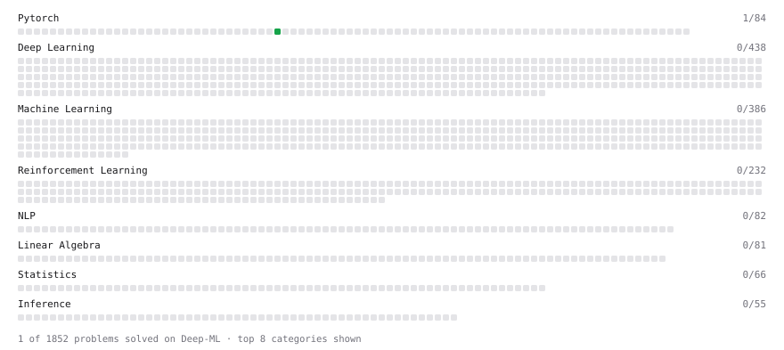

# Deep-ML

My machine learning practice from [Deep-ML](https://www.deep-ml.com). Every solution here was written by hand.

**6** solved · 5 problems · 1 labs · 0 math

[**Browse the interactive portfolio**](https://georgezliao.github.io/deep-ml/) to replay this filling in over time.

## Problems

| | Difficulty | Solved | |
| --- | --- | --- | --- |
| [Create and Inspect a Tensor](https://www.deep-ml.com/problems/1220) | easy | 2026-10-30 | [solution](problems/1220-create-and-inspect-a-tensor) |
| [Derivative of a Polynomial](https://www.deep-ml.com/problems/116) | easy | 2026-06-24 | [solution](problems/0116-derivative-of-a-polynomial) |
| [Gradient of a Square with Autograd](https://www.deep-ml.com/problems/1222) | easy | 2026-10-30 | [solution](problems/1222-gradient-of-a-square-with-autograd) |
| [Reshape and Transpose a Tensor](https://www.deep-ml.com/problems/1221) | easy | 2026-10-30 | [solution](problems/1221-reshape-and-transpose-a-tensor) |
| [Gradient of a Weighted Sum of Squares](https://www.deep-ml.com/problems/1223) | medium | 2026-10-30 | [solution](problems/1223-gradient-of-a-weighted-sum-of-squares) |

## Labs

| | Difficulty | Solved | |
| --- | --- | --- | --- |
| [Fit Linear Regression with Autograd](https://www.deep-ml.com/labs/9ff596ea-672e-4101-9ce4-0856c55b62c9) | medium | 2026-10-31 | [solution](labs/9ff596ea-672e-4101-9ce4-0856c55b62c9-fit-linear-regression-with-autograd) |

---

_This file is regenerated by Deep-ML on every push._
